# 지하 콘크리트 구조물의 결함 탐지·분할과 영상 단위 판정

딥러닝프로그래밍 · Step 3 · 21114073 차경호

지하 구조물의 표면 영상에서 **균열, 백태, 박리·박락의 위치와 모양을 찾고, 각 결함이 포함된 영상을 선별**하는 프로젝트다. YOLOv8s-Seg가 출력하는 인스턴스 마스크로 결함 영역을 평가하고, 클래스별 예측 신뢰도로 영상 단위 ON/OFF를 판정한다. 한 영상에 여러 결함이 있으면 여러 클래스가 동시에 ON이 된다.

1주차에는 결함의 정의와 주석 기준을 정리했고, 2주차에는 CVAT 주석과 데이터 점검, 원본 단위 분할과 기초 모델 학습을 수행했다. 3주차에는 추가 학습 13개와 추론 조건을 비교하고, 검증 영상에서 정한 임계값을 테스트 영상에 적용했다. 이 README는 데이터 준비부터 모델 선택, 최종 평가와 오류 분석까지의 결과를 담는다.

## 결과 한눈에 보기

| 평가 집합 | 영상 단위 macro F1 | Mask mAP50 | Mask mAP50–95 |
| --- | --- | --- | --- |
| 검증 14장 | 85.19% | 70.94% | 24.48% |
| 테스트 16장 | 66.93% | 44.36% | 25.09% |

**최종 모델은 BatchNorm 통계를 고정한 추가 학습 K의 15에폭 가중치이며, 추론 입력 크기는 1280이다.** 검증에서 선택한 임계값은 균열 0.001, 백태 0.010, 박리·박락 0.001이다. 총 90개 검증 조건에서 모델과 임계값을 선택한 뒤 테스트 결과를 산출했다.

[실습 보고서 PDF](reports/Step3_3주차_실습과제_21114073_차경호.pdf) · [주석 기준서 PDF](reports/Step3_3주차_주석기준서_21114073_차경호.pdf) · [전체 실험 조건](results/experiments/training_runs.csv) · [검증 조건별 결과](results/validation_comparison.csv)

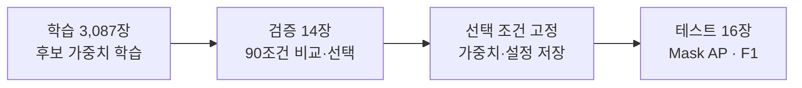

학습 자료로 가중치를 학습하고, 검증 자료로 가중치·추론 크기·클래스별 임계값을 선택한다. 테스트에는 선택한 조합을 고정해서 적용한다. 마스크 평가는 결함 영역의 일치도를, ON/OFF 평가는 결함이 있는 영상의 선별 능력을 측정한다.

## 1. 문제 정의와 데이터

### 결함을 어떻게 구분하는가

| 클래스 | 영상에서 확인할 형태 | 폴리곤 주석 범위 |
|---|---|---|
| 균열 · `crack` · ID 0 | 가늘고 길게 이어지는 표면 불연속, 굴곡과 분기 | 원본에서 보이는 균열 양쪽 경계 사이. 연결된 분기는 형태를 따라 포함한다. |
| 백태 · `efflorescence` · ID 1 | 콘크리트 표면의 백색·담색 침착, 불규칙한 덩어리와 흐름 자국 | 배경과 구분되는 침착 영역의 외곽. 정상 표면으로 떨어진 덩어리는 나누어 그린다. |
| 박리·박락 · `spall_detach` · ID 2 | 표면층 분리, 들뜸이나 재료 탈락으로 드러난 손상부 | 정상 표면과 손상부가 만나는 외곽. 외곽 밖으로 이어진 그림자는 제외한다. |

사각형만으로 표시하면 가는 균열 주변의 정상 표면이나 백태 덩어리 사이의 빈 공간까지 함께 둘러싸게 된다. 인스턴스 분할은 결함마다 별도의 마스크를 출력하므로 결함 종류·위치·외곽을 함께 확인할 수 있다. 이 프로젝트에서는 세 클래스를 같은 모델로 학습한다.

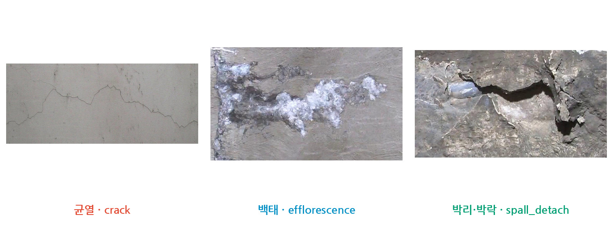

왼쪽부터 균열, 백태, 박리·박락이 나타난 영상이다. 폴리곤은 영상에서 식별되는 결함의 경계를 따라 작성한다. 균열은 실제로 보이는 폭을 유지하고, 백태와 박리·박락은 배경으로 분리되는 부분을 연결해서 크게 둘러싸지 않는다.

시공 이음부와 케이블, 강한 그림자는 균열과 비슷한 선형 구조를 만든다. 밝은 도장면과 반사는 백태와 비슷한 색을 보일 수 있다. 주석에서는 밝기나 선 모양 하나만 보지 않고 주변 표면과의 연결, 반복되는 시공 형태, 결함 경계가 실제로 드러나는지를 함께 확인한다. 같은 기준을 예측 결과의 오탐 분석에도 적용한다.

### 데이터 규모와 사용 범위

제공 자료는 영상 파일 4,116개와 대응 라벨로 구성되었다. 영상 복호화, 라벨 좌표, 중복 영상과 원본·증강 관계를 점검한 뒤 3,117개를 사용했다. 학습 자료에는 정상적으로 읽히고 라벨이 대응하는 **증강 영상 2,923개**를 포함했다.

| 점검 결과 | 영상 수 | 처리 내용 |
|---|---:|---|
| 제공 자료 | 4,116 | 전체 영상·라벨 점검 |
| 사용 자료 | 3,117 | 학습 3,087장, 검증 14장, 테스트 16장 |
| 0바이트 파일 | 63 | 영상 데이터가 없어 제외 |
| 동일 픽셀 중복 | 31 | 같은 영상의 중복 집계에서 제외 |
| 수동 주석의 기존 파생본 | 369 | 변경한 주석에서 다시 생성하지 않은 파생본 제외 |
| 검증·테스트 그룹의 비원본 | 536 | 평가 집합을 원본 영상으로 구성하면서 제외 |

0바이트 파일에는 영상 내용이 저장되어 있지 않다. 정상적인 증강 영상은 학습에 사용하고, 주석을 변경한 원본의 파생본은 새 좌표 변환 관계를 확보한 경우에 사용했다. 추가 실험 F에서는 학습에 속한 수동 주석 원본 6장으로부터 138개의 새 변환본을 생성했다.

### 같은 촬영 장면이 양쪽에 들어가지 않도록 분할

증강본을 파일마다 독립적으로 무작위 분할하면 같은 장면의 원본이 학습에, 회전본이 테스트에 들어갈 수 있다. 이 경우 테스트는 새로운 장면에 대한 평가 역할을 잃는다. 따라서 촬영 계열과 원본 ID, 동일 픽셀 관계를 묶어 그룹을 만들고 그룹 단위로 분할했다. 원본과 증강본은 같은 집합에 속한다.

| 집합 | 영상 수 | 촬영 그룹 | 원본 ID | 저장된 증강 영상 | 사용 목적 |
|---|---:|---:|---:|---:|---|
| 학습 | 3,087 | 76 | 164 | 2,923 | 모델의 가중치 학습 |
| 검증 | 14 | 7 | 14 | 0 | 모델·추론 조건·임계값 선택 |
| 테스트 | 16 | 8 | 16 | 0 | 선택 조건의 성능 측정 |

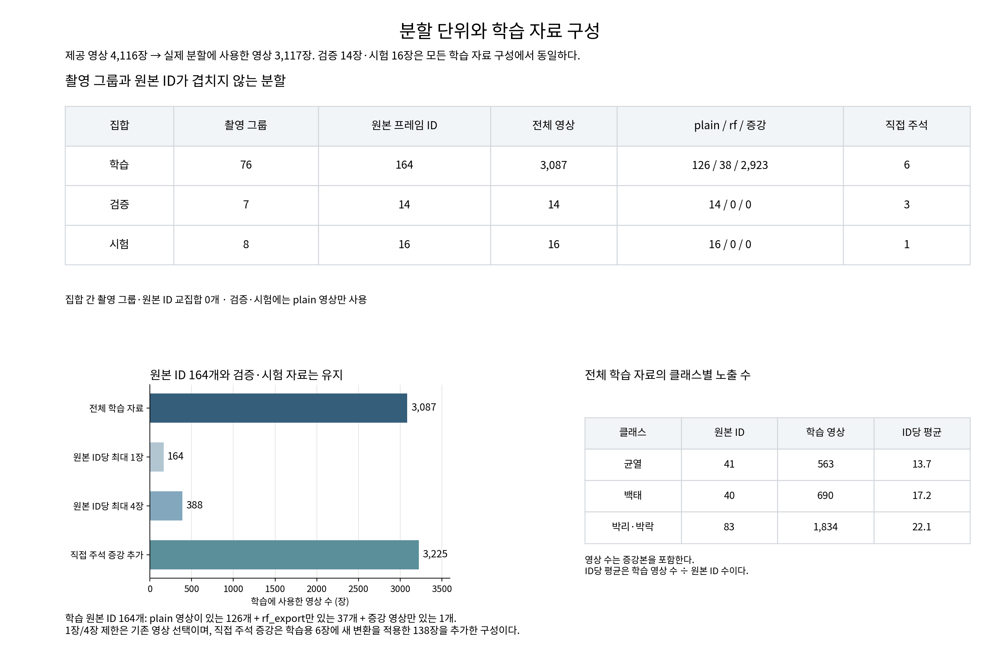

학습 영상 3,087장은 서로 다른 원본 3,087장을 뜻하지 않는다. 164개 원본 ID에서 나온 영상과 증강본이므로, 원본마다 파생본 수가 다르면 학습에서 반복되는 비중도 달라진다. 원본당 표본 수 제한과 클래스·원본 균형 샘플링을 추가 실험으로 비교한 이유다.

| 클래스 | 학습 양성 영상 | 검증 양성 영상 / 인스턴스 | 테스트 양성 영상 / 인스턴스 |
|---|---:|---:|---:|
| 균열 | 563 | 2 / 2 | 4 / 5 |
| 백태 | 690 | 5 / 6 | 4 / 6 |
| 박리·박락 | 1,834 | 7 / 9 | 8 / 10 |
| 합계 | 3,087 | 14 / 17 | 16 / 21 |

영상 한 장에 같은 클래스의 폴리곤이 여러 개 있으면 인스턴스 수는 증가하지만, 영상 단위 양성은 한 장으로 센다. 검증·테스트에는 세 결함이 모두 없는 정상 영상이 없으므로, 클래스별 음성은 다른 결함을 포함한 영상들이다. 예를 들어 균열의 TN은 백태·박리·박락 영상에서 균열 경보를 켜지 않은 경우다.

### CVAT 주석과 YOLO Segmentation 라벨

CVAT에서 주석한 영상 10장에는 폴리곤 12개가 있다. 원래 분할을 유지하여 학습 6장, 검증 3장, 테스트 1장에 반영했다. 주석의 변경과 실험별 증강은 구분해서 기록했으며, 모델 비교에는 같은 검증·테스트 라벨을 사용했다.

YOLO Segmentation 라벨은 인스턴스 하나를 한 행에 기록한다. 첫 값은 클래스 ID이고, 이후 값은 폴리곤 꼭짓점의 정규화 좌표 쌍이다.

```text
class_id x1 y1 x2 y2 ... xn yn
```

영상 너비가 W, 높이가 H일 때 픽셀 좌표 (u, v)를 (u/W, v/H)로 저장한다. 좌표는 0부터 1 사이이고, 꼭짓점은 경계를 따라 순서대로 연결한다. 시각 점검에서는 라벨을 다시 원본 영상에 겹쳐 폭과 분기, 떨어진 영역의 연결 여부를 확인했다.

## 2. 모델과 학습 방법

### YOLOv8s-Seg의 입력과 출력

모델은 RGB 영상을 입력받아 인스턴스별 클래스, 신뢰도, 박스와 마스크를 출력한다. 특징 추출부는 서로 다른 해상도의 특징을 만들고, 분할 출력부는 이 특징으로 결함의 위치와 형태를 추정한다. 최종 결과에서는 같은 클래스의 여러 결함을 개별 인스턴스로 유지한다. 모델 구조는 모든 실험에서 YOLOv8s-Seg로 고정했다.

초기 가중치는 COCO 사전학습 모델을 사용했다. COCO의 80클래스 출력부를 이번 과제의 3클래스에 맞추어 학습하고, 후속 실험에서는 이미 학습된 결함 모델의 가중치에서 시작했다. 처음부터 학습한 조건과 추가 미세조정 조건은 초기화와 학습 시간을 구분해서 비교했다.

입력 크기 `imgsz`는 원본의 종횡비를 유지한 크기 조정과 패딩에 사용된다. 학습 입력 960과 1280을 비교했고, 추론 입력 크기도 별도 조건으로 평가했다. **학습 입력 크기와 추론 입력 크기는 서로 다른 설정**이다. 1280으로 학습한 모델을 960으로 평가할 수 있으며, 이때 가중치는 그대로이고 추론에 들어가는 영상 표현만 달라진다.

### 기초 모델과 공통 설정

| 항목 | 2주차 기초 모델 | 추가 실험의 공통 조건 |
|---|---|---|
| 모델 | COCO 사전학습 YOLOv8s-Seg | 같은 YOLOv8s-Seg 구조 |
| 클래스 | 균열·백태·박리·박락 | 동일 |
| 학습 입력 | 960 | 실험에 따라 960 또는 1280 |
| 배치 / data loader workers | 4 / 2 | 4 / 0 |
| optimizer | AdamW | AdamW |
| 초기 학습률 | 0.00015 | 아래 실험 조건표에 명시 |
| epoch | 최대 60, 46 완료 | 실험별 10~100 |
| 선택 가중치 | 26에폭 | 실험별 검증 지표로 선택 |
| Mosaic / MixUp | 0 / 0 | 0 / 0 |
| seed | 42 | 42 |

Mosaic는 여러 영상을 하나로 합치고, MixUp은 서로 다른 영상을 겹친다. 이번 실습에서는 결함의 외곽과 주변 표면 문맥을 유지하도록 두 값을 0으로 설정했다. 저장된 증강본과 HSV 변화, 크기·위치 변화, 좌우 반전은 별도로 사용했다. 약한 증강 실험에서는 이 중 색과 기하 변환의 강도만 줄였다.

기초 학습은 Box mAP50–95와 Mask mAP50–95의 합으로 가중치를 선택했다. 추가 실험 A–D도 같은 기준을 사용했고, E–M은 Mask mAP50–95를 사용했다. 따라서 학습 곡선에서 선택한 에폭은 Mask mAP50만 가장 높은 시점과 다를 수 있다. 저장된 각 후보 가중치는 공통 평가 조건에서 다시 비교했다.

### 추가 학습 13개

| 조건 | 변경 내용 | 출발 가중치 | 학습 영상 | 입력 | 초기 학습률 | 완료 / 상한 | 학습 중 선택 에폭 |
| --- | --- | --- | --- | --- | --- | --- | --- |
| A | 기초 모델 추가 학습 | 기초 | 3,087 | 960 | 3e-05 | 15 / 15 | 10 |
| B | 입력 크기 1280 | 기초 | 3,087 | 1280 | 3e-05 | 15 / 15 | 7 |
| C | 원본 ID당 최대 1장 | 기초 | 164 | 1280 | 3e-05 | 30 / 30 | 15 |
| D | 원본 ID당 최대 4장 | 기초 | 388 | 1280 | 3e-05 | 30 / 30 | 3 |
| E | COCO 시작 · 최대 4장 | COCO | 388 | 1280 | 0.00015 | 37 / 100 | 12 |
| F | 직접 주석의 새 증강 138장 | B | 3,225 | 1280 | 1e-05 | 10 / 10 | 2 |
| G | COCO 시작 · 전체 학습 자료 | COCO | 3,087 | 960 | 0.0003 | 100 / 100 | 97 |
| H | 균일 표본 추출로 추가 학습 | G | 3,087 | 960 | 1.5e-05 | 30 / 30 | 22 |
| I | 클래스·원본별 균등 추출 | G | 3,087 | 960 | 1.5e-05 | 30 / 30 | 2 |
| J | 색상·이동·크기 증강 완화 | G | 3,087 | 960 | 1.5e-05 | 30 / 30 | 18 |
| K | BatchNorm 이동 통계 고정 | G | 3,087 | 960 | 1.5e-05 | 30 / 30 | 3 |
| L | 분류 손실 가중치 1.0 | G | 3,087 | 960 | 1.5e-05 | 30 / 30 | 12 |
| M | COCO 시작 · 입력 크기 1280 | COCO | 3,087 | 1280 | 0.0003 | 100 / 100 | 47 |

표의 선택 에폭은 각 학습 실행 내부의 선택 기준으로 고른 값이다. 이후 고정 간격으로 저장한 에폭도 공통 검증에 포함했으며, 최종 K의 15에폭 가중치는 이 공통 비교에서 선택했다.

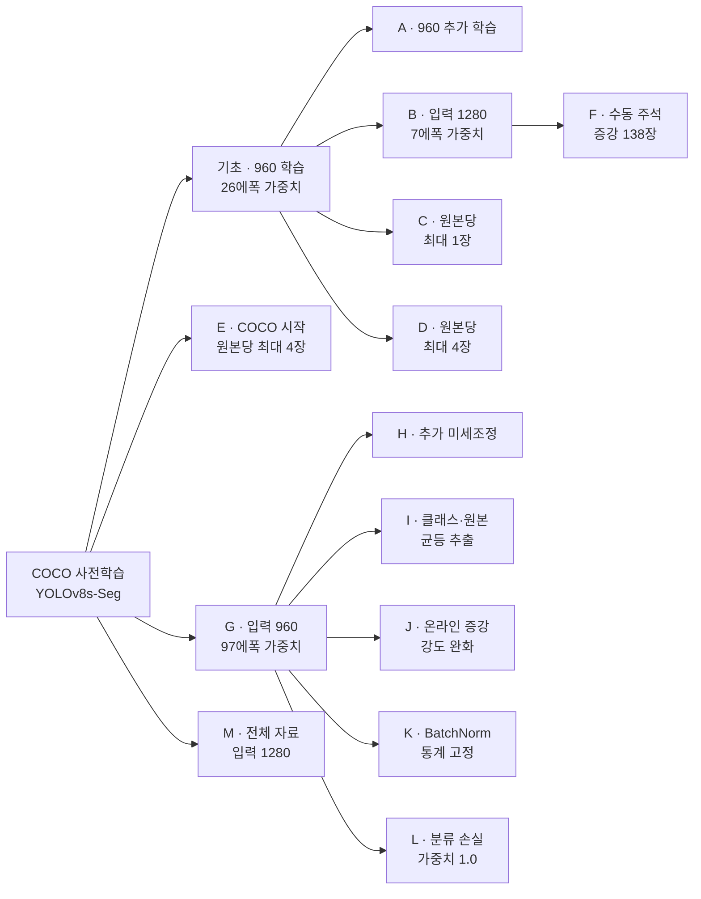

화살표는 각 실험의 출발 가중치를 나타낸다. A–D는 2주차 모델에서, F는 B에서, H–L은 G에서 시작했다. E·G·M은 COCO 사전학습 모델에서 출발했다. 같은 부모를 가진 조건끼리 바뀐 설정과 결과를 비교하면 추가 학습의 효과를 구체적으로 읽을 수 있다.

**A·B — 추가 학습의 입력 크기.** 같은 기초 가중치와 학습 영상 3,087장을 사용하고, 입력 크기만 960과 1280으로 나누었다. 초기 학습률은 0.00003이고 15에폭씩 학습했다. 새 AdamW를 사용했으며 warmup의 bias 학습률도 같은 값으로 설정했다. 이후 각 가중치를 여러 추론 크기에서 평가하여 학습 해상도와 추론 해상도의 영향을 나누어 보았다.

**C·D — 원본당 학습 표본 수.** 증강본이 많은 원본에 학습이 집중되는지를 확인하기 위해 원본 ID당 최대 1장과 4장을 선택했다. 학습 영상은 각각 164장과 388장이다. 원본당 반복 비중과 전체 학습 단계 수가 함께 바뀌므로 두 변화를 함께 해석한다. 164장 조건은 일반 파일 126장, `.rf.` 내보내기 형태만 존재하는 대표본 37장, 증강 형태만 존재하는 대표본 1장으로 구성되었다.

**E — 작은 학습 집합에서 COCO 초기화.** D와 같은 388장으로 COCO 사전학습 가중치부터 학습했다. 입력은 1280, 초기 학습률은 0.00015, 최대 100에폭과 patience 25를 사용했다. 실제로는 37에폭에서 조기 종료되었다. 이 조건은 100에폭 전체 학습과 구분하여 표에 기록했다.

**F — 수동 주석의 기하 증강.** B에서 출발해 학습용 수동 주석 영상 6장에 회전·반전 8종과 밝기 계수 0.85·1.00·1.15를 조합했다. 원본과 같은 조합 하나를 제외하면 영상당 23장, 총 138장이 추가되어 학습 자료는 3,225장이 된다. 영상과 폴리곤에 같은 변환을 적용하고, 검증·테스트 영상은 이 증강에 사용하지 않았다.

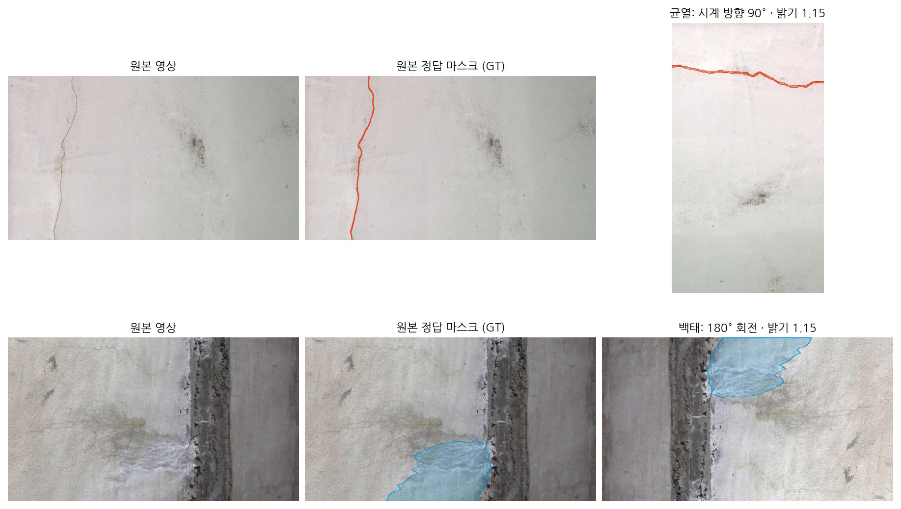

왼쪽부터 원본, 원본의 정답 마스크, 변환 영상과 변환한 정답 마스크다. 정규화 좌표의 좌우 반전은 (x, y) → (1−x, y), 시계방향 90도 회전은 (x, y) → (1−y, x)로 계산한다. 밝기 변환은 픽셀 값만 바꾸므로 폴리곤 좌표를 유지한다.

**G — 전체 학습 자료로 100에폭 학습.** COCO 가중치에서 시작하여 3,087장 전체를 입력 960으로 100에폭 학습했다. 초기 학습률은 0.0003이고 `mask_ratio`를 2로 설정했다. `mask_ratio`는 학습용 정답 마스크를 축소하는 비율이다. 값 2는 값 4보다 촘촘한 학습용 마스크를 사용한다. 공통 성능 비교에서는 모든 후보에 같은 마스크 평가 설정을 적용했다.

**H·I — 추가 미세조정과 표본 균형.** G의 선택 가중치를 초기값으로 30에폭을 더 학습했다. H는 기존 영상 샘플링을 유지했고, I는 클래스 → 원본 ID → 해당 원본의 영상 순으로 균등하게 뽑았다. 두 조건의 한 에폭 표본 수는 3,087개이며, I는 복원 추출을 사용했다. 따라서 균형 샘플링에서는 같은 영상이 반복되거나 어떤 영상이 그 에폭에 선택되지 않을 수 있다.

**J — 온라인 증강 강도.** H와 같은 조건에서 HSV 변화량과 위치·크기 변화량만 줄였다. HSV 설정은 0.015/0.7/0.4에서 0/0.1/0.1로, 이동 범위는 0.1에서 0.02로, 크기 변화는 0.5에서 0.1로 바꾸었다. 디스크에 이미 저장된 증강 자료는 유지했다.

**K — BatchNorm 통계 고정.** H와 같은 조건에서 BatchNorm의 이동평균과 이동분산을 G의 값으로 유지했다. 작은 배치로 추가 학습하면서 특징의 정규화 통계가 달라지는 영향을 살펴보기 위한 조건이다. BatchNorm의 학습 가능한 크기·이동 계수는 계속 갱신하고, 모델과 EMA의 통계 버퍼를 고정했다.

**L — 분류 손실 가중치.** H와 같은 조건에서 분류 손실의 계수 `cls`를 0.5에서 1.0으로 높였다. 전체 손실에서 분류 항이 차지하는 비중을 높이는 설정이며, 특정 결함 클래스에만 별도 가중치를 주는 방식은 아니다. 마스크 영역 학습과 클래스 신뢰도 학습의 비중이 달라졌을 때 두 평가 지표가 어떻게 바뀌는지 확인했다.

**M — 전체 자료의 1280 학습.** G의 설정에서 학습 입력만 1280으로 높여 100에폭을 수행했다. 50에폭 이후 저장된 모델·optimizer·EMA 상태를 복원했고, 75에폭 저장 후 다시 이어 100에폭까지 완료했다. 학습률 일정은 전체 100에폭 기준을 유지했다. 이 실행의 학습 이력에는 두 재개 시점을 함께 표시했다.

### 학습 곡선에서 확인한 변화

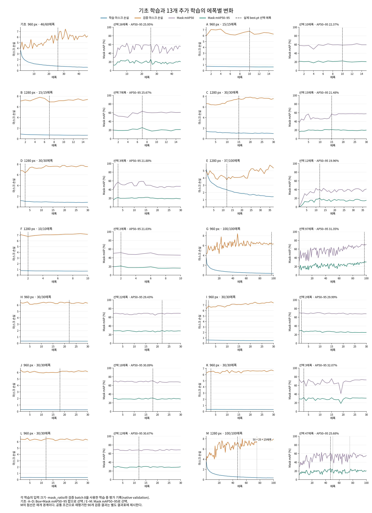

G는 100에폭 중 97에폭에서 학습 중 검증 Mask mAP50–95가 31.35%로 가장 높았다. 초기 34에폭 이후 한동안 최고값을 갱신하지 않다가 82에폭에서 다시 개선되었다. 이 실행에서는 짧은 patience로 종료하면 뒤쪽의 개선 구간을 확인하기 어려웠다. 학습 기간을 늘린 결과는 마지막 에폭 하나보다 전체 곡선과 선택 시점을 함께 보았다.

G에서 추가 학습한 H·I·J·K·L의 학습 중 선택 Mask mAP50–95는 각각 29.43%·29.99%·30.89%·32.07%·30.67%였다. BatchNorm 통계를 고정한 K가 이 평가에서 가장 높았고, 단순 연장 H와 분류 손실 비중을 높인 L은 G의 31.35%보다 낮았다. 같은 출발점에서 학습을 더 했다는 사실만으로 검증 성능이 증가하지 않았다.

I의 균형 샘플링은 클래스별 추출 횟수를 비슷하게 맞췄지만, 뒤쪽 에폭의 검증 점수는 낮아졌다. G와 비교하면 학습 분포를 바꾸는 것이 영상 단위 선별과 마스크 경계를 동시에 개선하는지는 별도의 결과로 확인해야 한다. J의 약한 증강도 H보다 높은 마스크 점수를 얻었지만 G를 넘지는 못했다.

M은 100에폭을 모두 수행했고, 학습 중 최고 Mask mAP50–95는 47에폭의 25.68%였다. 마지막 에폭은 20.13%로 최고점보다 낮았다. 1280 입력에서 결함을 더 많은 픽셀로 표현했어도 이 실행의 검증 성능은 G보다 낮았다. M의 최고점은 50에폭 중단 이전에 기록되었으며, 이후 구간은 저장 상태를 이어 학습했다.

이 곡선은 학습 중 배치 8의 검증 기록이다. 다음 절의 공통 검증은 배치 1·FP32와 같은 후처리 조건을 사용한다. 학습 중 선택값과 공통 비교값을 각각의 평가 조건으로 기록했다.

## 3. 두 평가 지표와 클래스별 임계값

### 마스크의 위치와 형태: IoU와 AP

정답 영역을 G, 예측 영역을 P라고 하면 IoU는 두 영역의 교집합을 합집합으로 나눈 값이다.

$$
\mathrm{IoU}(G,P)=\frac{|G\cap P|}{|G\cup P|}
$$

예측이 정상 표면까지 넓어지면 합집합이 커지고, 결함 일부를 놓치면 교집합이 줄어든다. 두 경우 모두 IoU가 낮아진다. 정답과 예측의 크기가 같아도 위치가 어긋나면 점수가 감소한다.

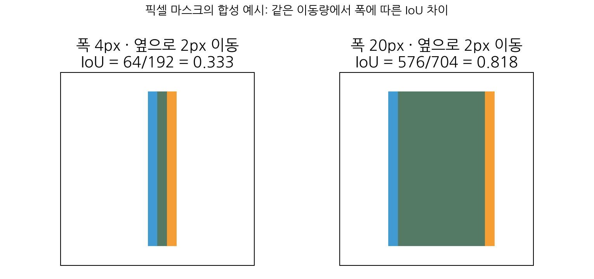

이 그림은 같은 길이의 직사각형 마스크를 2픽셀 옆으로 이동한 계산 예시다. 폭이 4픽셀이면 겹친 폭은 2, 합친 폭은 6이어서 IoU가 1/3이다. 폭이 20픽셀이면 18/22 ≈ 0.818이다. 가는 결함에서 작은 위치 오차가 큰 점수 차이로 이어지는 원리를 보여준다. 실제 결과에서는 이 원리와 함께 미탐·중복 검출·클래스 혼동도 살펴본다.

AP는 예측을 신뢰도 순으로 정렬하여 정밀도와 재현율의 관계를 요약한 값이다. 정해진 IoU 기준에서 정답과 대응한 예측은 TP로, 대응하지 못한 예측은 FP로 집계하고, 놓친 정답은 재현율을 낮춘다. 한 클래스의 AP를 계산한 뒤 세 클래스를 평균하면 mAP가 된다.

| 지표 | 계산 기준 | 확인하는 성능 |
|---|---|---|
| Mask AP50 | 마스크 IoU ≥ 0.50 | 한 클래스의 결함 영역 검출·분할 |
| Mask AP50–95 | IoU 0.50~0.95, 0.05 간격의 10개 기준 평균 | 엄격한 외곽 일치까지 포함한 분할 |
| Mask mAP | 클래스별 Mask AP 평균 | 세 클래스의 종합 분할 성능 |
| Box mAP | 외접 사각형의 IoU로 평가 | 박스 위치 성능 |

과제의 분할 지표는 `metrics.seg`에서 계산한 Mask mAP다. 공통 평가에서는 `conf=0.001`, NMS `iou=0.7`, `max_det=300`, batch 1과 FP32를 사용했다. NMS의 IoU는 겹치는 예측을 정리하는 기준이고, AP 계산의 IoU는 예측과 정답을 대응시키는 기준이다. 두 값은 서로 다른 단계에 쓰인다.

### 영상에 결함이 있는가: ON/OFF

영상 x에서 클래스 c의 예측 신뢰도 중 최댓값을 s_c(x)라고 한다. 해당 클래스의 예측이 하나도 없으면 0으로 둔다. 클래스별 임계값 τ_c 이상인 예측이 하나라도 있으면 그 영상의 해당 결함을 ON으로 판정한다.

$$
\hat y_c(x)=\mathbf{1}[s_c(x)\geq\tau_c]
$$

정답 역시 클래스 c의 폴리곤이 하나 이상 있으면 ON이다. 같은 영상에 균열 3개가 있어도 영상 단위 평가는 균열 양성 한 장으로 집계한다. 여러 결함 가운데 하나만 찾아도 영상 단위 TP가 될 수 있으므로, 이 결과와 마스크 영역의 정확도를 함께 읽는다.

| 판정 | 정답 | 예측 | 의미 |
|---|---|---|---|
| TP | ON | ON | 해당 결함이 있는 영상을 선택 |
| FP | OFF | ON | 해당 클래스 정답이 없는 영상을 선택 |
| FN | ON | OFF | 해당 결함이 있는 영상을 누락 |
| TN | OFF | OFF | 해당 클래스 정답이 없는 영상을 제외 |

$$
\mathrm{Precision}=\frac{TP}{TP+FP},\qquad
\mathrm{Recall}=\frac{TP}{TP+FN},\qquad
F1=\frac{2TP}{2TP+FP+FN}
$$

정밀도는 선택한 영상 중 실제 양성의 비율이고, 재현율은 실제 양성 중 선택한 비율이다. F1은 두 지표의 조화평균이다. Macro F1은 균열·백태·박리·박락의 F1을 같은 비중으로 평균한다. 따라서 테스트 양성이 8장인 박리·박락과 4장인 백태가 종합 F1에서 같은 비중을 갖는다.

### 검증에서 선택하고 테스트에 고정

임계값 후보는 **0.001, 0.004, 0.010, 0.020, 0.060, 0.100, 0.200, 0.300**이다. 검증 영상 14장의 예측을 한 번 저장하고, 같은 예측에 여덟 후보를 적용하여 클래스별 F1을 계산했다. F1이 가장 높은 후보를 선택하고 동률이면 낮은 값을 골랐다.

예측 수집에는 `conf=0.0001`을 사용했다. 탐색할 최솟값 0.001보다 낮게 수집해야 0.001에서 선택할 예측이 앞 단계에서 잘리지 않는다. 신뢰도는 모델의 출력 점수이며, 값 0.20을 실제 정답 확률 20%로 환산하지 않는다.

| 임계값 | 균열 F1 | 백태 F1 | 박리·박락 F1 |
| --- | --- | --- | --- |
| 0.001 | 0.6667 | 0.7273 | 1.0000 |
| 0.004 | 0.6667 | 0.8000 | 1.0000 |
| 0.010 | 0.6667 | 0.8889 | 1.0000 |
| 0.020 | 0.6667 | 0.8889 | 1.0000 |
| 0.060 | 0.6667 | 0.8889 | 1.0000 |
| 0.100 | 0.6667 | 0.8889 | 0.9231 |
| 0.200 | 0.6667 | 0.7500 | 0.8333 |
| 0.300 | 0.0000 | 0.7500 | 0.8333 |

| 클래스 | 선택 임계값 | TP / FP / FN / TN | Precision | Recall | F1 |
| --- | --- | --- | --- | --- | --- |
| 균열 | 0.001 | 1 / 0 / 1 / 12 | 100.00% | 50.00% | 66.67% |
| 백태 | 0.010 | 4 / 0 / 1 / 9 | 100.00% | 80.00% | 88.89% |
| 박리·박락 | 0.001 | 7 / 0 / 0 / 7 | 100.00% | 100.00% | 100.00% |

균열은 양성 2장 중 1장, 백태는 5장 중 4장, 박리·박락은 7장 모두를 선택했다. 세 클래스 모두 선택 임계값에서 FP는 0장이었다. 균열과 백태의 미탐이 남아 검증 macro F1은 85.19%였다. 선택값과 검증 예측은 [임계값 기록](results/tune/selected_thresholds.json)과 [원시 예측](results/tune/validation_predictions.json)에 저장했다.

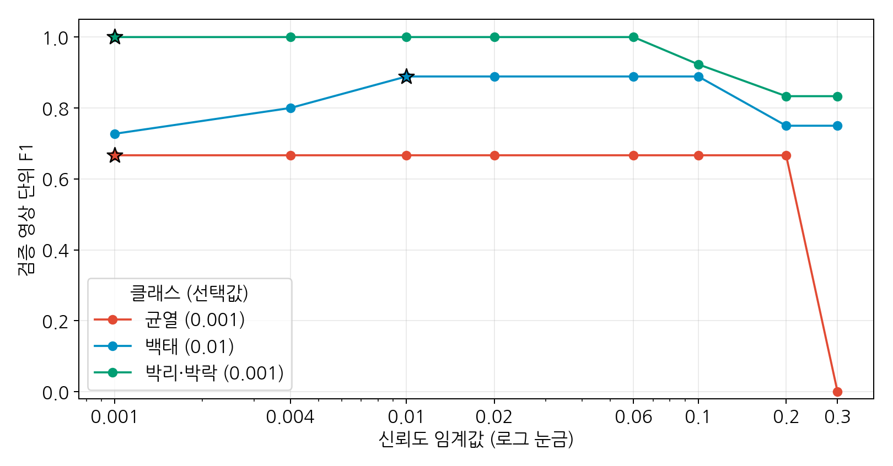

별표는 최대 F1을 얻는 후보 중 가장 낮은 임계값이다. 여러 후보가 같은 F1을 보이는 구간에서는 영상의 ON/OFF 판정이 그대로 유지된다. 곡선과 실제 TP·FP·FN을 함께 보면 임계값 선택이 어떤 영상을 추가하거나 제외했는지 확인할 수 있다.

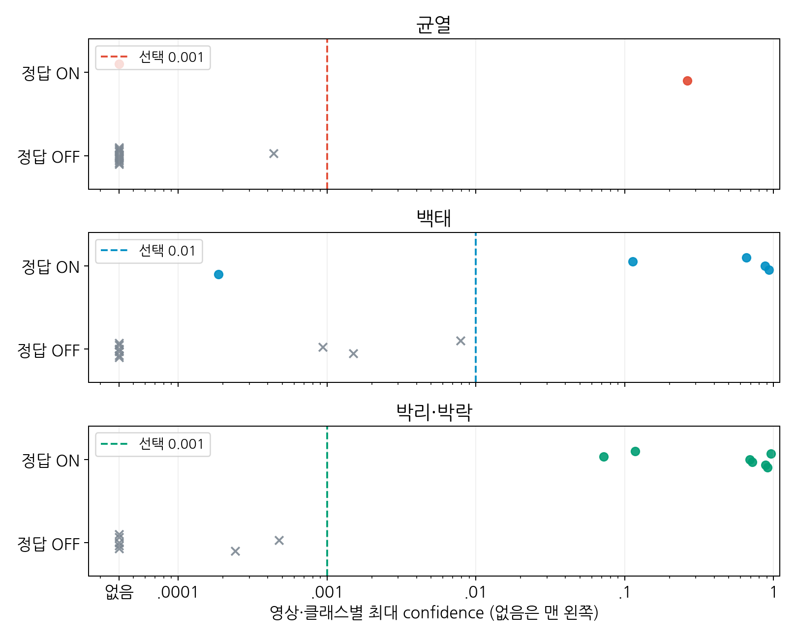

클래스별 양성·음성 영상의 최대 신뢰도와 선택 임계값을 함께 표시했다. 임계값을 높이면 FP뿐 아니라 TP도 줄어들 수 있다. 양성과 음성의 점수 범위가 겹치면 임계값만 바꾸어 두 집합을 완전히 분리할 수 없으며, 모델의 특징 표현과 신뢰도 순위가 함께 개선되어야 한다.

## 4. 공통 검증 조건에서 모델 비교

추가 학습마다 입력 크기와 샘플링, 증강 등의 설정이 다르므로, 저장된 후보 가중치를 같은 검증 영상·라벨과 평가 코드로 다시 평가했다. 기본 추론 크기는 960과 1280이며, B에 대해서는 640·800·1152·1536도 비교했다. G·H·I·J·K의 사전에 정한 중간 에폭 가중치를 포함하여 총 90조건을 비교했다.

체크포인트마다 여덟 후보의 검증 F1로 클래스별 임계값을 정했다. 후보 선택은 검증 macro F1을 우선하고, 동률이면 Mask mAP50, Mask mAP50–95, 작은 입력 크기 순으로 비교했다. 기초 모델에 대한 성능 조건과 세 목표 수치의 동시 만족 여부는 함께 기록했다. 전체 후보는 [검증 비교표](results/validation_comparison.csv)에 담았다.

아래 표는 각 학습 실행의 선택 가중치에서 검증 F1을 우선해 고른 추론 크기와 결과다. 마지막 행은 고정 간격 에폭까지 비교하여 선택한 최종 조건이다.

| 학습 조건 | 추론 크기 | macro F1 | Mask mAP50 | Mask mAP50–95 |
| --- | --- | --- | --- | --- |
| 기초 | 960 | 82.96% | 60.04% | 25.94% |
| A | 960 | 82.96% | 58.69% | 22.75% |
| B | 960 | 85.19% | 63.28% | 27.10% |
| C | 960 | 80.00% | 61.67% | 25.99% |
| D | 960 | 82.22% | 60.79% | 25.83% |
| E | 1280 | 81.10% | 40.17% | 19.96% |
| F | 960 | 85.19% | 60.35% | 25.10% |
| G | 1280 | 85.19% | 57.31% | 20.41% |
| H | 1280 | 85.19% | 57.97% | 20.64% |
| I | 1280 | 85.19% | 66.28% | 26.33% |
| J | 1280 | 85.19% | 49.15% | 22.24% |
| K | 1280 | 85.19% | 64.56% | 22.53% |
| L | 1280 | 85.19% | 55.28% | 18.66% |
| M | 1280 | 81.10% | 62.16% | 26.39% |
| **K · 15에폭** | **1280** | **85.19%** | **70.94%** | **24.48%** |

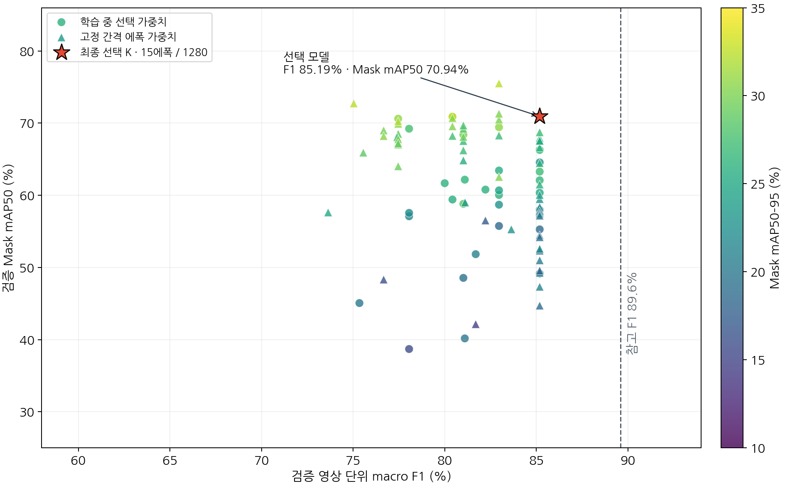

한 점은 가중치와 추론 크기를 조합한 평가 조건이다. 같은 구조에서도 학습 과정과 체크포인트, 입력 크기에 따라 영상 선별 F1과 마스크 성능이 다르게 움직였다. 모델을 고를 때 한 지표의 개선을 다른 지표의 개선으로 바꾸어 해석하지 않고 두 축을 함께 비교했다.

기초 모델의 추론 960 결과는 F1 82.96%, Mask mAP50 60.04%, Mask mAP50–95 25.94%였다. 최종 K 15에폭/1280은 F1이 +2.22%p, Mask mAP50이 +10.90%p 높았고, Mask mAP50–95는 -1.47%p 차이를 보였다. 영상 선별과 IoU 0.50의 분할은 개선되었지만, 더 엄격한 경계 기준까지 평균한 지표에서는 같은 방향의 개선을 얻지 못했다.

K의 15에폭 가중치를 960으로 추론하면 F1 82.96%, Mask mAP50 75.51%, Mask mAP50–95 32.45%였다. 같은 가중치를 1280으로 추론하면 F1은 85.19%로 높아지고 두 마스크 지표는 70.94%·24.48%로 낮아졌다. 최종 선택은 영상 선별 F1을 우선하는 규칙에 따라 1280을 사용했다. 이 비교는 가중치를 그대로 둔 상태에서 추론 크기만 바꾼 결과다.

추가 실험 L의 추론 960 결과는 F1 81.02%·Mask mAP50–95 29.89%, M의 추론 1280 결과는 F1 81.10%·Mask mAP50–95 26.39%였다. 두 실험은 기존 최종 후보의 F1을 높이지 못했다. 완료된 90개 조건 중 가장 높은 검증 F1은 85.19%였고, 세 참고 목표를 동시에 만족한 조건은 없었다.

가중치의 학습 중 마스크 최고점과 영상 선별에 가장 유리한 시점은 달랐다. K의 학습 중 선택은 3에폭이지만, 고정 간격 가중치를 공통 조건에서 비교했을 때 15에폭/1280이 최종 순위의 앞에 놓였다. 검증 점수만으로 선택한 뒤 아래 테스트에서 같은 조건을 평가했다.

## 5. 테스트 성능

테스트 16장에 K의 15에폭 가중치와 입력 1280, 클래스별 임계값 0.001·0.010·0.001을 적용했다. 모델·입력·임계값은 테스트 실행 전에 [선택 기록](results/selection.json)에 고정했다. 테스트에는 정답 인스턴스 21개가 포함되어 있다.

### 클래스별 마스크 분할 성능

| 클래스 | 정답 인스턴스 | Mask AP50 | Mask AP50–95 |
| --- | --- | --- | --- |
| 균열 | 5 | 38.56% | 21.63% |
| 백태 | 6 | 24.87% | 19.89% |
| 박리·박락 | 10 | 69.64% | 33.76% |
| 전체 평균 | 21 | 44.36% | 25.09% |

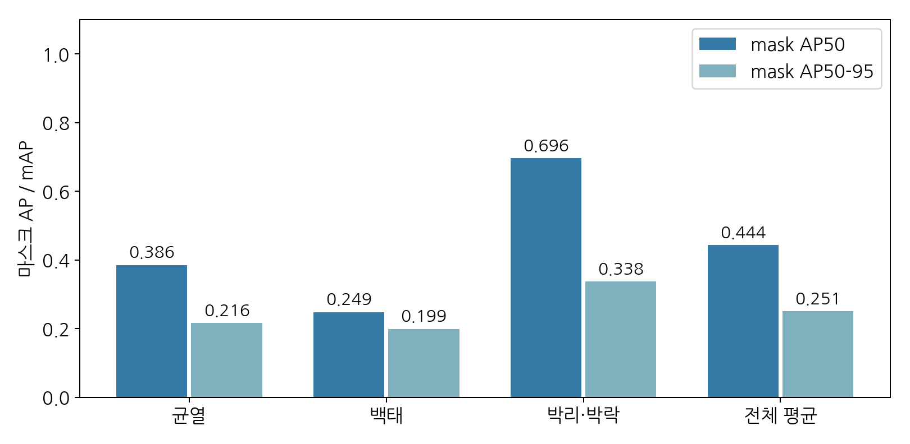

AP50–95는 IoU 0.50뿐 아니라 더 엄격한 경계 일치 기준까지 평균한다. AP50과의 차이는 외곽 정확도뿐 아니라 신뢰도 순서, 인스턴스 누락과 중복의 영향을 함께 받는다. 아래 원본·정답·예측 그림에서 실제 위치와 모양을 같이 확인했다.

### 클래스별 영상 단위 ON/OFF

| 클래스 | 임계값 | TP | FP | FN | TN | Precision | Recall | F1 |
| --- | --- | --- | --- | --- | --- | --- | --- | --- |
| 균열 | 0.001 | 3 | 2 | 1 | 10 | 60.00% | 75.00% | 66.67% |
| 백태 | 0.010 | 1 | 0 | 3 | 12 | 100.00% | 25.00% | 40.00% |
| 박리·박락 | 0.001 | 8 | 1 | 0 | 7 | 88.89% | 100.00% | 94.12% |

**테스트 macro F1은 66.93%이다.** 클래스별 정밀도·재현율·F1은 영상 단위 TP·FP·FN으로 계산했다.

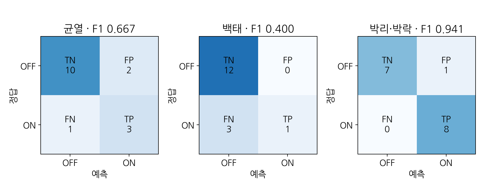

행은 정답, 열은 예측이다. 세 클래스마다 테스트 영상 16장을 평가하므로 각 혼동행렬의 네 칸 합은 16이다. 이것은 세 클래스를 서로 하나로만 분류하는 혼동행렬과 다르며, 클래스별로 결함이 있는지 판단한 결과다.

**균열:** 양성 4장 중 3장을 선택하고 1장을 놓쳤다. 음성 12장 중 2장에서 해당 클래스의 경보가 발생했다. 정밀도는 60.00%, 재현율은 75.00%, F1은 66.67%였다.

**백태:** 양성 4장 중 1장을 선택하고 3장을 놓쳤다. 음성 12장 중 0장에서 해당 클래스의 경보가 발생했다. 정밀도는 100.00%, 재현율은 25.00%, F1은 40.00%였다.

**박리·박락:** 양성 8장 중 8장을 선택하고 0장을 놓쳤다. 음성 8장 중 1장에서 해당 클래스의 경보가 발생했다. 정밀도는 88.89%, 재현율은 100.00%, F1은 94.12%였다.

### 기존 평가와 비교

| 평가 모델 / 추론 크기 | macro F1 | Mask mAP50 | Mask mAP50–95 |
| --- | --- | --- | --- |
| 2주차 기초 모델 · 960 | 65.40% | 42.27% | 22.15% |
| B · 960 | 68.29% | 29.32% | 17.08% |
| I · 1280 | 60.78% | 44.08% | 25.19% |
| K · 15에폭 / 1280 | 66.93% | 44.36% | 25.09% |

각 행은 해당 시점에 검증으로 고정한 모델과 임계값의 테스트 기록이다. 최종 모델은 위의 공통 검증 절차로 선택했다. 이 표는 모델을 바꾸면서 테스트 결과가 어떻게 달라졌는지를 보여준다.

## 6. 원본·정답·예측으로 보는 오류

비교 그림은 **원본 → 정답 마스크 → 예측 마스크** 순서다. 빨강은 균열, 파랑은 백태, 초록은 박리·박락이다. 예측 그림은 클래스별 선택 임계값 이상인 인스턴스를 표시한다. 영상 단위 FP·FN과 마스크의 위치·폭 차이를 함께 살펴보았다.

### 균열: 손상부의 외곽과 선형 구조를 함께 보는 경우

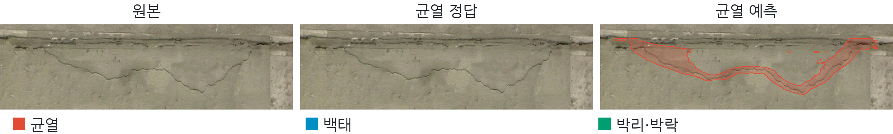

**T02 · 균열 FP.** 이 영상의 정답은 박리·박락으로 등록되어 있다. 모델은 손상부 아래쪽의 굽은 선을 따라 균열 마스크도 출력했고, 최대 신뢰도 0.282204가 균열 임계값 0.001을 넘어 균열 FP가 되었다. 원본에서 선형 경계는 뚜렷하지만, 정답은 그 경계로 둘러싸인 손상 영역을 박리·박락으로 구분한다. 모델이 영역의 경계와 결함의 종류를 함께 구별하는 데 어려움을 보인 사례다.

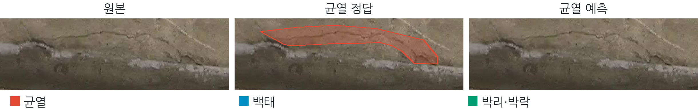

**T11 · 균열 FN.** 수평으로 이어진 표면 불연속을 균열로 주석한 영상이다. 원본에는 가는 경계와 그 아래의 어두운 띠가 함께 보인다. 균열 클래스의 예측은 수집 신뢰도 0.0001 이상에서 나오지 않았고, 같은 영상의 넓은 띠를 박리·박락으로 예측했다. 이 영상은 균열 FN과 박리·박락 FP에 동시에 포함된다.

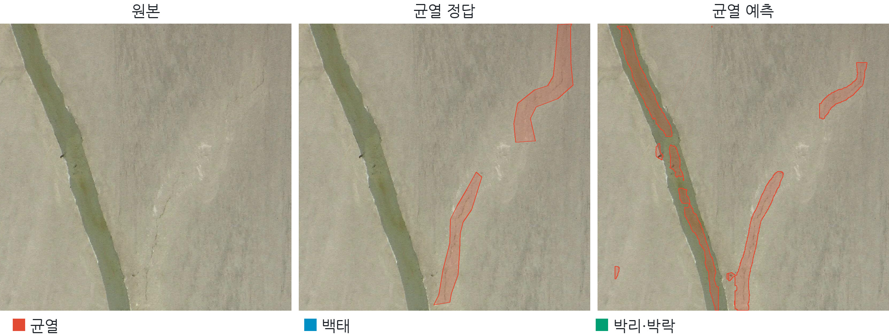

**T04 · 균열 TP와 마스크의 차이.** 균열 신뢰도는 0.875617로 영상 단위 TP였다. 예측에는 오른쪽 균열의 일부와 함께 왼쪽의 긴 이음부를 따라 나온 마스크가 있다. 정답과 만나는 예측이 있어도 주변의 다른 선형 구조에 출력이 추가될 수 있다. 영상 단위 TP 한 장이라는 결과에 마스크의 과다 예측과 끊김을 함께 확인한 이유다.

균열은 테스트 양성 4장 중 3장을 선택했다. 음성 영상 12장에서는 T01과 T02 두 장을 균열로 선택했다. T01의 균열 최대 신뢰도는 0.003747로 낮은 점수의 오탐이고, T02는 0.282204로 상대적으로 높은 점수의 클래스 혼동이다. 두 오탐을 같은 원인으로 묶기보다 주변 질감에서 나온 작은 예측과 손상 외곽에서 나온 긴 예측으로 구분했다.

### 백태: 경계가 약한 밝은 침착 영역의 누락

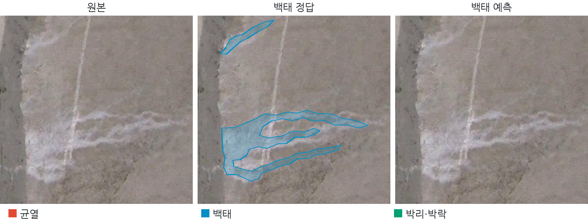

**T01 · 백태 FN.** 위쪽의 작은 밝은 자국과 아래쪽의 넓은 침착 영역이 정답 폴리곤으로 표시되어 있다. 원본에서는 밝은 침착이 표면의 줄무늬와 거친 질감에 섞여 보인다. 백태 예측은 수집 신뢰도 이상에서 나오지 않아 두 영역이 모두 누락되었다. 한 장의 영상 단위 FN에 여러 인스턴스의 누락이 포함되는 사례다.

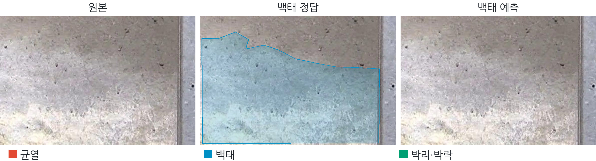

**T13 · 백태 FN.** 영상 아래쪽에 밝은 침착이 넓게 퍼져 있고, 정상 표면과의 경계가 점진적으로 이어진다. 정답은 이 넓은 영역을 표시했지만 백태 예측은 나오지 않았다. 뚜렷한 덩어리보다 밝기 변화와 표면 질감이 함께 나타나는 장면에서 미탐이 발생했다.

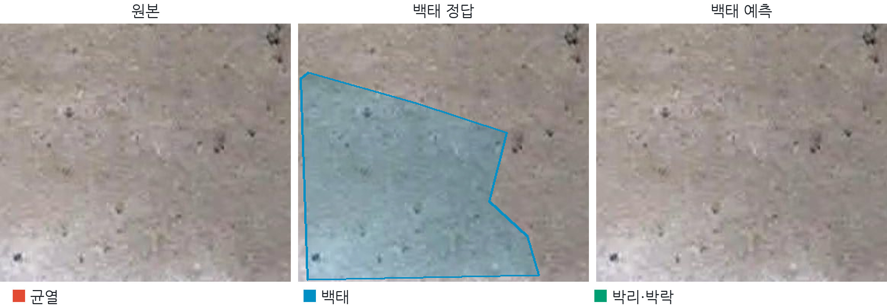

**T14 · 백태 FN.** 밝은 표면 위로 얼룩과 작은 점들이 분포하며 백태 경계가 희미하다. 백태 최대 신뢰도는 0.001311로, 검증에서 선택한 0.010보다 낮아 OFF가 되었다. T01·T13은 수집 단계에서 해당 클래스의 예측이 없었고, T14는 예측 점수가 판정 기준보다 낮았다. 같은 FN이라도 예측이 생성되는 단계와 ON/OFF 판정 단계의 차이가 있다.

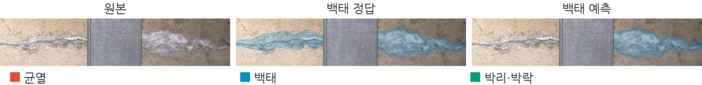

**T07 · 백태 TP.** 금속 부재 양쪽에 백태 정답 영역이 있으며, 모델은 오른쪽 영역을 0.935140의 신뢰도로 예측했다. 왼쪽 정답 영역은 예측에 포함되지 않았지만 백태 인스턴스 하나가 임계값을 넘어 영상 단위 TP로 집계되었다. 백태의 영상 단위 재현율 25.00%와 인스턴스 분할 지표를 별도로 보는 사례다.

백태는 테스트 양성 4장 중 1장만 선택했고 FP는 0장이었다. 정밀도는 100%지만 재현율은 25.00%, F1은 40.00%였다. 선택한 백태 영상은 정답이었으나 대부분의 양성 영상을 놓쳤다는 의미다. 세 클래스 중 영상 선별 F1과 Mask AP50이 모두 가장 낮았다.

### 박리·박락: 영상 선별과 손상 면적 추정의 차이

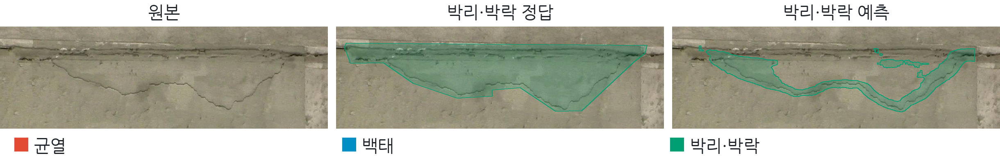

**T02 · 박리·박락 TP.** 넓은 손상부가 정답으로 표시되어 있고, 예측은 주로 외곽을 따라 좁게 이어진다. 박리·박락 신뢰도 0.005603이 임계값 0.001을 넘어 영상 단위로는 TP였다. 손상부가 있는 영상을 골랐더라도 정답 면적 전체를 채운 것은 아니며, 이 차이는 마스크 겹침 평가에 반영된다.

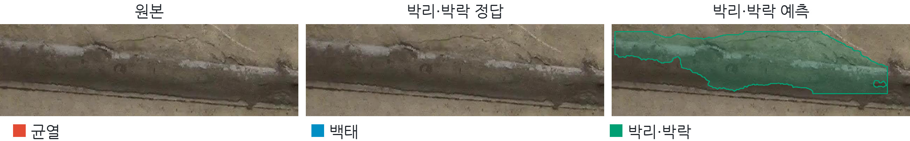

**T11 · 박리·박락 FP.** 정답에는 균열만 있지만 모델은 수평 경계 아래의 넓고 어두운 띠를 박리·박락으로 예측했다. 최대 신뢰도는 0.568731이었다. 균열의 가는 경로와 그 주변 표면 변화가 한 장면에 함께 나타나며, 모델의 출력은 가는 경로보다 넓은 영역 쪽으로 형성되었다.

박리·박락은 양성 8장을 모두 선택했고 음성 8장 중 1장에서 FP가 발생했다. 재현율은 100%, 정밀도는 88.89%, F1은 94.12%였다. 이 테스트 집합에서 박리·박락 FN은 0장이므로 미탐 사례는 없다. Mask AP50은 69.64%, AP50–95는 33.76%였으며, 영상 선별 결과와 손상 영역의 정밀한 일치는 구분된다.

### 사례를 묶어서 본 관찰

균열과 박리·박락에서는 한 손상부의 선형 외곽과 내부 영역 사이에서 클래스가 겹치거나 바뀌는 예측이 보였다. 백태에서는 경계가 희미한 밝은 침착 영역의 누락이 주로 나타났다. 정답과 예측을 같은 원본 좌표에 겹쳐 보면서 클래스 혼동, 예측 부재, 낮은 신뢰도와 불완전한 면적 추정을 구분했다. 이러한 구분은 다음 데이터 보강에서 어떤 장면과 주석 기준을 먼저 점검할지 정하는 근거가 된다.


전체 테스트 16장의 판정과 대응 파일은 [영상별 결과표](results/test/image_decisions.csv)에, 전체 비교 그림은 [테스트 사례](docs/cases.md)에 정리했다. 대표 사례의 번호는 전체 결과표와 같은 순서다.

## 7. 실행 방법과 코드 구조

### 실행 환경

| 항목 | 추가 학습·공식 평가 환경 |
|---|---|
| Python | 3.10.12 |
| PyTorch / CUDA | 2.6.0+cu124 / 12.4 |
| Ultralytics | 8.4.12 |
| GPU | NVIDIA GeForce RTX 4090, 24 GB |
| 학습 / 평가 배치 | 4 / 1 |
| data loader workers / CPU 스레드 | 0 / 2 |
| 학습 정밀도 / 공식 평가 정밀도 | AMP / FP32 |
| seed | 42 |

평가를 재현할 때에는 저장소의 선택 가중치와 설정을 사용한다. 새 학습 결과는 별도 출력 폴더에 저장한다. 아래 명령은 저장소 루트에서 실행한다.

```bash
python3.10 -m venv .venv
source .venv/bin/activate
python -m pip install -r requirements-cuda.txt
```

CPU 환경에서는 `requirements-cpu.txt`로 설치하고 평가 명령에 `--device cpu`를 붙인다. 공식 결과표는 위 GPU 환경에서 얻은 값이다. 별도의 작업 폴더에서 이 저장소의 코드와 배포 가중치로 검증 14장·테스트 16장을 다시 실행했으며, 인스턴스의 박스·마스크·신뢰도와 클래스별 판정·AP가 공식 결과와 일치했다.

### 데이터 준비

수업에서 제공한 자료를 `data/original`에 풀어 `images`와 `labels` 폴더가 들어가도록 배치한다. 분할 목록과 수동 주석 파일은 저장소에 포함되어 있다. 다음 명령은 목록에 기록된 원본·라벨을 확인하고 학습·검증·테스트 집합을 구성한다.

```bash
python -I -B src/prepare_data.py \
  --source data/original \
  --output work/dataset
```

`work/dataset`에는 영상 링크, 정규화한 라벨 사본과 `data.yaml`이 생성된다. 클래스 순서는 `crack`, `efflorescence`, `spall_detach`이다. 원본 영상과 제공 라벨은 그대로 유지하며, 수동 주석 대상에는 포함된 주석 파일을 적용한다.

```yaml
train: images/train
val: images/val
test: images/test
names:
  0: crack
  1: efflorescence
  2: spall_detach
```

### 선택 모델로 검증·테스트 재실행

```bash
python -I -B src/evaluate.py preflight \
  --data work/dataset --weights weights/selected.pt \
  --output results/reproduction

python -I -B src/evaluate.py tune \
  --data work/dataset --weights weights/selected.pt \
  --output results/reproduction

python -I -B src/evaluate.py test \
  --data work/dataset --weights weights/selected.pt \
  --output results/reproduction
```

`preflight`는 입력 파일과 클래스·분할을 확인한다. `tune`은 검증 14장의 예측과 여덟 후보의 F1 표, 선택 임계값을 저장한다. `test`는 그 기록에 맞는 모델·설정인지 확인한 뒤 선택값을 테스트 16장에 적용한다. 출력은 `results/reproduction/tune`과 `results/reproduction/test`에 저장된다.

GPU 실행은 GPU 0이 비어 있을 때 시작한다. 배치 사이에 다른 GPU 연산 프로세스가 나타나면 현재 실행을 중단한다. PyTorch 메모리 할당 상한은 GPU 메모리의 50%이고, CPU 스레드는 2개를 사용한다. 설정과 캐시는 실행별 출력 폴더 아래에 둔다.

### 선택 모델의 학습 과정 재실행

선택 모델은 **COCO에서 100에폭 학습한 G → BatchNorm 통계를 고정한 30에폭 추가 학습 K → K의 15에폭 가중치** 순서로 만들어졌다. 초기 COCO 가중치는 다음 고정 버전에서 받는다.

```bash
curl -L --fail \
  https://github.com/ultralytics/assets/releases/download/v8.3.0/yolov8s-seg.pt \
  --output weights/yolov8s-seg.pt

python -I -B src/train.py \
  --config configs/train_coco.json --data work/dataset \
  --weights weights/yolov8s-seg.pt --output work/train_coco
```

G 학습이 끝나면 그 실행의 선택 가중치를 K의 초기값으로 사용한다. `--weights-sha256`에는 이번 실행에서 생성한 파일의 SHA를 전달한다.

```bash
parent_sha=$(sha256sum work/train_coco/weights/best.pt | cut -d ' ' -f 1)
python -I -B src/train.py \
  --config configs/train_frozenbn.json --data work/dataset \
  --weights work/train_coco/weights/best.pt \
  --weights-sha256 "$parent_sha" --output work/train_frozenbn
```

에폭 파일은 0부터 번호를 붙이므로 15에폭은 `epoch14.pt`다. 이 가중치를 내보내어 같은 추론 조건으로 평가한다.

```bash
epoch_sha=$(sha256sum work/train_frozenbn/weights/epoch14.pt | cut -d ' ' -f 1)
python -I -B src/export_weights.py \
  --source work/train_frozenbn/weights/epoch14.pt \
  --expected-sha256 "$epoch_sha" --output work/retrained.pt

model_sha=$(sha256sum work/retrained.pt | cut -d ' ' -f 1)
python -I -B src/evaluate.py tune \
  --data work/dataset --weights work/retrained.pt \
  --weights-sha256 "$model_sha" --output results/retrained

python -I -B src/evaluate.py test \
  --data work/dataset --weights work/retrained.pt \
  --weights-sha256 "$model_sha" --output results/retrained
```

학습 명령에 `--check-only`를 추가하면 학습을 시작하기 전에 데이터와 초기 가중치만 검사한다. 새 학습에서는 해당 실행의 검증 임계값을 다시 구하고, 같은 실행의 테스트에 고정해서 적용한다.

### 그림과 보고서 재생성

그림은 저장된 예측과 수치를 사용한다. 원본·정답·예측 비교 그림을 다시 만들려면 앞 단계에서 준비한 `work/dataset`이 필요하다. 표와 학습 곡선은 포함된 CSV에서 생성한다. 한글 그림과 PDF에는 NanumGothic, NanumGothicBold, NanumGothicCoding 글꼴을 사용한다.

```bash
python -I -B src/make_experiment_figures.py
python -I -B src/make_validation_figure.py
python -I -B src/make_visuals.py --dataset work/dataset
python -I -B src/make_report.py
```

PDF는 이 README의 본문·표·그림으로 생성한다. 시스템에 나눔 글꼴이 없으면 TTF 파일을 `assets/fonts/nanum`에 두거나 PDF 명령의 `--font-dir`에 글꼴 폴더를 지정한다.

### 파일별 역할

| 파일 | 역할 |
|---|---|
| `src/prepare_data.py` | 고정 분할과 수동 주석으로 데이터 구성 |
| `src/train.py` | G·K 학습, 마스크 검증 지표와 에폭 저장 |
| `src/frozen_batchnorm.py` | K의 BatchNorm 통계와 EMA 버퍼 고정 |
| `src/evaluate.py` | 검증 임계값 선택, 고정 테스트와 마스크 AP 계산 |
| `src/runtime.py` | 실행별 설정·캐시와 CPU·GPU 사용 관리 |
| `src/export_weights.py` | 선택 에폭의 모델 가중치 내보내기 |
| `src/make_visuals.py` | 정답·예측 비교, F1 곡선, 혼동행렬과 오류 사례 |
| `src/make_experiment_figures.py` | 데이터 구성, 학습 계보와 14회 학습 곡선 |
| `src/make_validation_figure.py` | 90개 검증 조건의 성능 비교 그림 |
| `src/make_report.py` | README 보고서 PDF와 주석 기준서 생성 |

```text
README.md
├── src/                    데이터·학습·평가·그림·보고서 코드
├── configs/                G·K 학습 설정과 선택 모델 평가 설정
├── weights/selected.pt     최종 선택 가중치
├── data/                   고정 분할 목록과 데이터 통계
├── annotations/            CVAT 주석에서 반영한 라벨
├── results/
│   ├── experiments/        학습 설정·에폭별 수치
│   ├── tune/               검증 예측·임계값 후보·선택 결과
│   ├── test/               테스트 예측·클래스/영상별 판정·AP
│   └── validation_comparison.csv
├── docs/images/            README의 그래프와 실제 사례
├── docs/cases.md           테스트 16장 전체 비교
├── assets/guideline/       주석 기준서의 내용과 예시
├── environment/            실행 환경과 재현 입력 정보
└── reports/                실습 보고서와 주석 기준서 PDF
```


## 8. 결과 해석과 적용 범위

이번 실습에서는 결함의 외곽을 추정하는 마스크 분할과 결함이 포함된 영상을 고르는 ON/OFF 평가를 연결했다. 데이터는 촬영 그룹으로 분할했고, 증강본은 학습 집합에 포함했다. 추가 학습 13개와 추론·체크포인트를 조합한 90조건을 검증하여 K의 15에폭 가중치와 추론 크기 1280을 선택했다.

선택 모델의 테스트 결과는 Mask mAP50 44.36%, Mask mAP50–95 25.09%, 영상 단위 macro F1 66.93%였다. 검증에서 정한 세 임계값을 그대로 적용한 결과이며, 클래스별 오탐과 미탐을 원본 영상과 마스크로 확인했다.

입력 크기를 높이거나 학습 기간을 늘린 조건이 모든 지표에서 우세하지 않았다. 특히 같은 K 가중치에서도 추론 크기에 따라 F1과 마스크 AP의 변화 방향이 달랐다. 평가 목표를 먼저 정하고, 같은 분할에서 가중치·입력·임계값을 함께 확인하는 과정이 최종 선택에 필요했다.

**평가 표본.** 검증은 14장, 테스트는 16장이다. 테스트 균열과 백태는 양성이 각각 4장이므로 한 장의 TP·FN 변화가 재현율을 25%p 바꾼다. 검증 균열은 양성 2장이어서 한 장의 변화가 50%p에 해당한다. 수치는 이러한 영상 수와 클래스 구성을 함께 기준으로 읽는다.

**측정 단위.** 이 모델이 출력하는 마스크는 영상 픽셀 좌표다. 촬영 거리와 카메라 보정, 실제 길이 기준이 포함되어 있지 않아 균열 폭을 mm로, 결함 면적을 m²로 직접 산출하지 않는다. 이번 결과의 사용 범위는 결함 후보 영상의 선별과 영상 내 위치·형태 확인이다.

**모델 범위.** 비교한 조건들은 모두 YOLOv8s-Seg에 속한다. 학습 초기화와 기간, 표본 구성, 증강, BatchNorm 통계, 분류 손실 비중과 입력 해상도의 차이를 비교했다. 구조가 다른 분할 모델의 우열은 이 실험의 평가 범위에 포함하지 않았다.

### 강의 수치와 관련 연구

강의자료는 Mask mAP50 44.3%, Mask mAP50–95 22.2%, 영상 단위 macro F1 89.6%를 제시한다. 이번 실험은 원본 그룹으로 고정한 학습 3,087장·검증 14장·테스트 16장에 대한 결과다. 비교 표에는 이 데이터 규모와 평가 집합을 함께 표시한다.

공개 원문으로 확인한 김용환 외의 「YOLOv8-Seg 기반 지하 구조물 결함 탐지 및 분할 연구」는 균열·백태·박락 및 들뜸의 세 클래스를 다룬다. 논문은 전체 Mask mAP50 64.8%와 클래스별 73.1%·77.7%·43.7%를 보고했다. 논문의 F1–Confidence 곡선 최고값 0.58은 해당 분할 모델의 평가 곡선 값이고, 이번 과제의 영상 단위 ON/OFF macro F1은 별도로 계산했다. 관련 연구의 데이터 구성과 이번 실습 결과를 구분하여 참고했다.

## 참고자료

1. 딥러닝프로그래밍, *Step 3 지하구조물 결함 탐지* 및 *1·2·3주차 강의와 실습*. 데이터 주석, 원본 단위 분할, YOLOv8s-Seg 학습, 검증 임계값 선택과 테스트 평가 절차.
2. 김용환·김대희·김정훈·최상일, 「YOLOv8-Seg 기반 지하 구조물 결함 탐지 및 분할 연구」, 2026년도 한국통신학회 하계종합학술발표회, pp. 1112–1113. [논문 정보](https://www.dbpia.co.kr/journal/articleDetail?nodeId=NODE12964237).
3. Ultralytics, [Instance Segmentation](https://docs.ultralytics.com/tasks/segment/), [Performance Metrics](https://docs.ultralytics.com/guides/yolo-performance-metrics/). 분할 출력과 Mask·Box 지표의 의미.
4. Ultralytics v8.4.12, [YOLOv8-Seg 모델 설정](https://github.com/ultralytics/ultralytics/blob/v8.4.12/ultralytics/cfg/models/v8/yolov8-seg.yaml), [학습 구현](https://github.com/ultralytics/ultralytics/blob/v8.4.12/ultralytics/engine/trainer.py), [분할 평가 구현](https://github.com/ultralytics/ultralytics/blob/v8.4.12/ultralytics/models/yolo/segment/val.py).
