# 테스트 영상 16장 비교

[메인 보고서](../README.md) · [영상별 판정표](../results/test/image_decisions.csv)

왼쪽부터 원본, 정답 마스크, 선택 임계값을 적용한 예측 마스크다. 빨강은 균열, 파랑은 백태, 초록은 박리·박락이다.

## T01

원본: `URT008_2022_01_07_001_6854.jpg`

균열 **FP** (최대 신뢰도 0.003747, 임계값 0.001) · 백태 **FN** (수집 신뢰도 이상 예측 없음, 임계값 0.010) · 박리·박락 **TN** (최대 신뢰도 0.000280, 임계값 0.001)

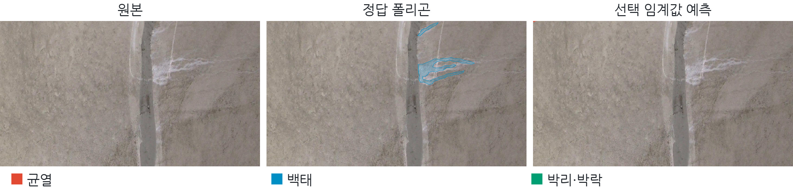

## T02

원본: `URT002_2021_03_16_001_8826.jpg`

균열 **FP** (최대 신뢰도 0.282204, 임계값 0.001) · 백태 **TN** (수집 신뢰도 이상 예측 없음, 임계값 0.010) · 박리·박락 **TP** (최대 신뢰도 0.005603, 임계값 0.001)

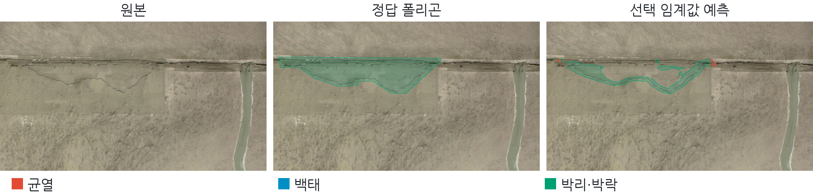

## T03

원본: `URT002_2021_03_16_001_14582.jpg`

균열 **TN** (수집 신뢰도 이상 예측 없음, 임계값 0.001) · 백태 **TN** (수집 신뢰도 이상 예측 없음, 임계값 0.010) · 박리·박락 **TP** (최대 신뢰도 0.609591, 임계값 0.001)

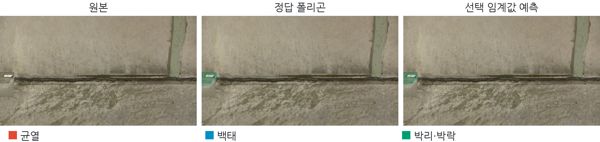

## T04

원본: `URT002_2021_03_16_001_7052.jpg`

균열 **TP** (최대 신뢰도 0.875617, 임계값 0.001) · 백태 **TN** (수집 신뢰도 이상 예측 없음, 임계값 0.010) · 박리·박락 **TN** (수집 신뢰도 이상 예측 없음, 임계값 0.001)

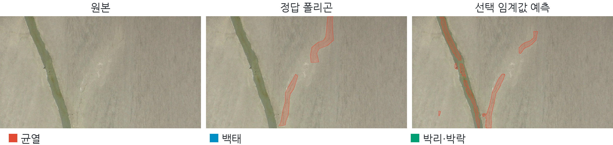

## T05

원본: `URT004_2021_03_07_001_14838.jpg`

균열 **TN** (수집 신뢰도 이상 예측 없음, 임계값 0.001) · 백태 **TN** (최대 신뢰도 0.000300, 임계값 0.010) · 박리·박락 **TP** (최대 신뢰도 0.345331, 임계값 0.001)

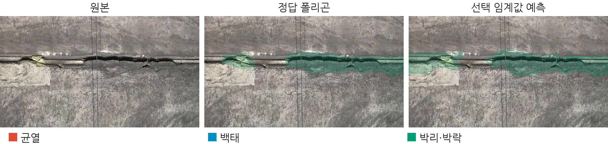

## T06

원본: `URT007_2022_01_14_001_6432.jpg`

균열 **TN** (최대 신뢰도 0.000498, 임계값 0.001) · 백태 **TN** (최대 신뢰도 0.001067, 임계값 0.010) · 박리·박락 **TP** (최대 신뢰도 0.655770, 임계값 0.001)

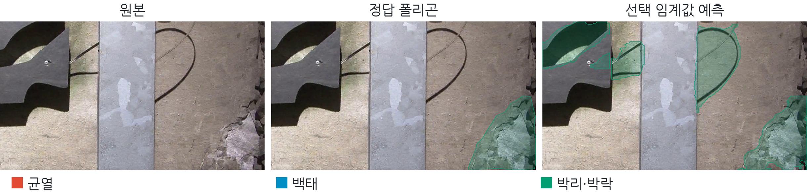

## T07

원본: `URT007_2022_01_14_001_5894.jpg`

균열 **TN** (최대 신뢰도 0.000145, 임계값 0.001) · 백태 **TP** (최대 신뢰도 0.935140, 임계값 0.010) · 박리·박락 **TN** (수집 신뢰도 이상 예측 없음, 임계값 0.001)

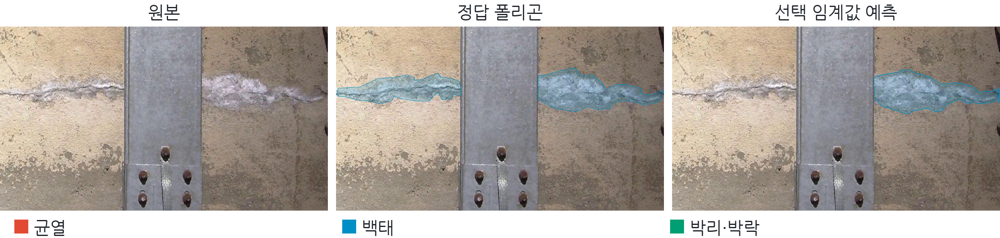

## T08

원본: `URT002_2021_03_16_001_14578.jpg`

균열 **TN** (수집 신뢰도 이상 예측 없음, 임계값 0.001) · 백태 **TN** (수집 신뢰도 이상 예측 없음, 임계값 0.010) · 박리·박락 **TP** (최대 신뢰도 0.776249, 임계값 0.001)

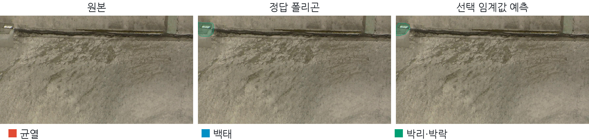

## T09

원본: `URT006_2022_02_10_001_6510.jpg`

균열 **TN** (수집 신뢰도 이상 예측 없음, 임계값 0.001) · 백태 **TN** (최대 신뢰도 0.000150, 임계값 0.010) · 박리·박락 **TP** (최대 신뢰도 0.034909, 임계값 0.001)

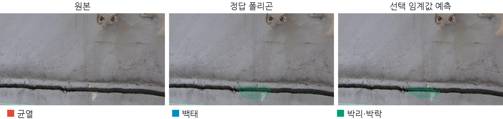

## T10

원본: `URT010_2022_01_09_001_2876.jpg`

균열 **TN** (수집 신뢰도 이상 예측 없음, 임계값 0.001) · 백태 **TN** (수집 신뢰도 이상 예측 없음, 임계값 0.010) · 박리·박락 **TP** (최대 신뢰도 0.516527, 임계값 0.001)

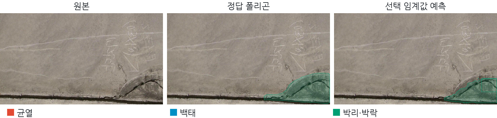

## T11

원본: `URT010_2022_02_06_991_7415.jpg`

균열 **FN** (수집 신뢰도 이상 예측 없음, 임계값 0.001) · 백태 **TN** (수집 신뢰도 이상 예측 없음, 임계값 0.010) · 박리·박락 **FP** (최대 신뢰도 0.568731, 임계값 0.001)

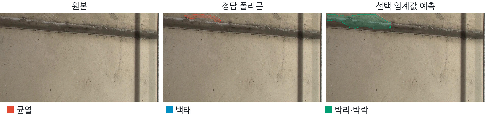

## T12

원본: `URT004_2021_03_07_001_18486.jpg`

균열 **TN** (수집 신뢰도 이상 예측 없음, 임계값 0.001) · 백태 **TN** (수집 신뢰도 이상 예측 없음, 임계값 0.010) · 박리·박락 **TP** (최대 신뢰도 0.833327, 임계값 0.001)

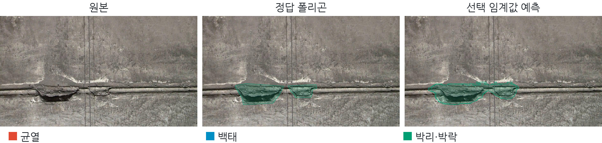

## T13

원본: `URT007_2022_01_14_001_4826.jpg`

균열 **TN** (수집 신뢰도 이상 예측 없음, 임계값 0.001) · 백태 **FN** (수집 신뢰도 이상 예측 없음, 임계값 0.010) · 박리·박락 **TN** (최대 신뢰도 0.000355, 임계값 0.001)

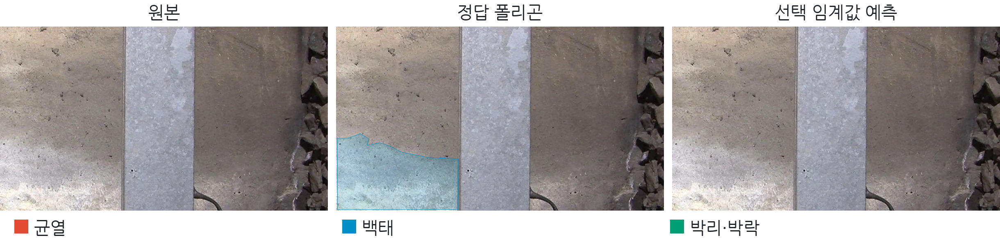

## T14

원본: `URT007_2022_01_14_001_4830.jpg`

균열 **TN** (수집 신뢰도 이상 예측 없음, 임계값 0.001) · 백태 **FN** (최대 신뢰도 0.001311, 임계값 0.010) · 박리·박락 **TN** (최대 신뢰도 0.000385, 임계값 0.001)

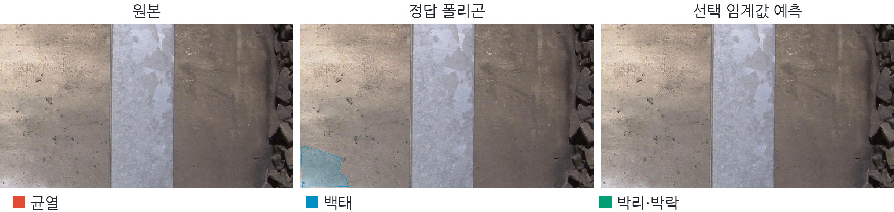

## T15

원본: `URT017_2020_02_05_001_17847.jpg`

균열 **TP** (최대 신뢰도 0.812304, 임계값 0.001) · 백태 **TN** (수집 신뢰도 이상 예측 없음, 임계값 0.010) · 박리·박락 **TN** (수집 신뢰도 이상 예측 없음, 임계값 0.001)

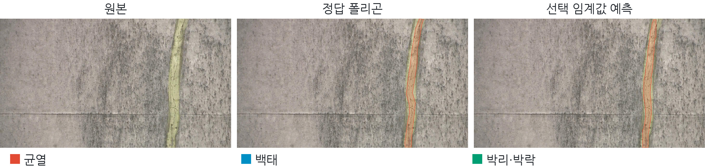

## T16

원본: `URT017_2020_02_05_001_5519.jpg`

균열 **TP** (최대 신뢰도 0.795372, 임계값 0.001) · 백태 **TN** (수집 신뢰도 이상 예측 없음, 임계값 0.010) · 박리·박락 **TN** (수집 신뢰도 이상 예측 없음, 임계값 0.001)

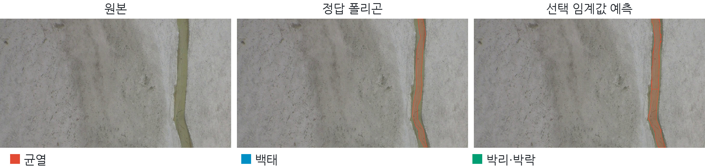
